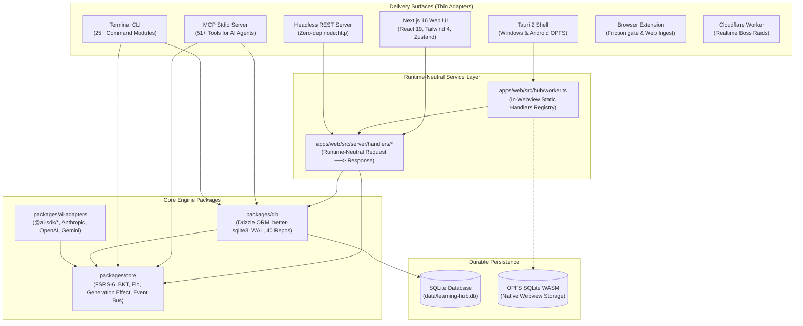
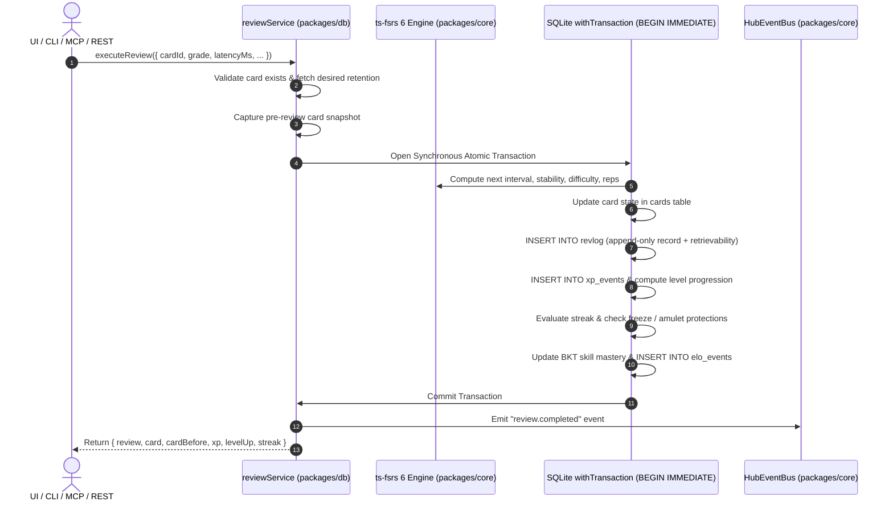

# Learning HUB — Architecture Reference

> **Comprehensive Architecture Blueprint & Deep Component Map**
> **Current Revision:** 2.0 (Post-Cognitive-Expansion Milestone)
> **Verified against codebase:** 2026-11-17

---

## 1. High-Level Architectural Topology

Learning HUB follows a strict **Hexagonal / Ports-and-Adapters** architectural paradigm with unidirectional dependency flow. Pure domain logic and scheduling algorithms reside at the absolute bottom of the dependency graph with zero I/O, persistence models are strictly centralized in the database package, and external delivery mechanisms (HTTP, CLI, stdio MCP, Cloudflare Workers, Tauri Webviews) act as thin presentation/transport adapters.

---

## 2. Package & Module Map

### 2.1 `packages/core` (Pure Domain Logic)

Zero I/O, zero Node.js dependencies, zero `ai` SDK imports. Completely isomorphic and runs in any JavaScript runtime.

| Domain                  | Files / Directories                                                                                            | Responsibilities                                                                                                                                                                                                    |
| ----------------------- | -------------------------------------------------------------------------------------------------------------- | ------------------------------------------------------------------------------------------------------------------------------------------------------------------------------------------------------------------- |
| **FSRS Scheduling**     | `fsrs.ts`, `fsrs-optimizer.ts`                                                                                 | `ts-fsrs` 6.0 scheduler, 21-parameter MAP weight optimizer, review reschedule math.                                                                                                                                 |
| **Cognitive Science**   | `generation/`, `metacognition/`, `feynman/`, `tmr/`, `interleaving/`, `dualcoding/`, `cognitive-load/`, `gkt/` | Slamecka-Graf generation effect, Koriat-Bjork calibration & Brier scores, Feynman teach-back & Rozenblit-Keil IOED evaluation, Rasch-Born sleep TMR cue scheduling, Leitner interleaving, cognitive load telemetry. |
| **Mastery & Rating**    | `bkt.ts`, `elo.ts`, `weakness.ts`                                                                              | Bayesian Knowledge Tracing ($P(L_0), P(T), P(S), P(G)$), Puzzle & Review Elo ladders, remedial targeting.                                                                                                           |
| **Cards & Linter**      | `cards.ts`, `linter.ts`, `doctor.ts`                                                                           | 8 card types (basic, cloze, stepwise MCQ, type-in, image occlusion, proof-step, grammar, sentence mining), 20-rules linter, Deck Doctor automated remediations.                                                     |
| **Human Systems**       | `xp.ts`, `streaks.ts`, `motivation.ts`, `habits.ts`, `focus.ts`, `focus-lock/`, `journal.ts`                   | Gamification milestones, streak freezes & weekend amulets, WOOP goal formulation, habit stacking, friction gate countdowns (10s reflection), dopamine menus.                                                        |
| **Curriculum**          | `curriculum/`, `curriculum.ts`, `practice/`                                                                    | LHCF (Learning HUB Curriculum Format) Track-Course-Unit-Lesson hierarchy, Bloom taxonomy verbs, prerequisite DAG validation, 12 interactive exercise engines.                                                       |
| **Event Bus & Plugins** | `events.ts`, `plugin.ts`, `plugin-loader.ts`                                                                   | Synchronous, isolated in-process event bus emitting durable facts (`HubEventMap`). Dynamic plugin lifecycle management.                                                                                             |
| **Ingest & Media**      | `ingest.ts`, `reading.ts`, `anki.ts`, `anki-export.ts`, `media.ts`, `ics.ts`                                   | SQ3R triaging, EPUB/HTML/Markdown parsing, Anki `.apkg` and TSV bidirectional import/export, ICS calendar generation.                                                                                               |

### 2.2 `packages/db` (Persistence & Repositories)

The sole writer of SQLite database state. Encapsulates transaction lifecycles and append-only constraints.

- **Schema:** `packages/db/src/schema.ts` defining 92 relational tables with typed JSON attributes.
- **Migrations:** `packages/db/src/migrations/` containing 27 versioned, strictly idempotent migrations (including SQLite FTS5 search indexes and E-ink Zen preferences).
- **Repositories:** 40 modular repository files under `packages/db/src/repos/` abstracting queries for decks, cards, analytics, audio, goals, habits, notes, ideas, reading, quests, and sync metadata.
- **The Canonical Review Service:** `packages/db/src/review-service.ts` owning `executeReview` and `executeBatchReview`.

### 2.3 `packages/ai-adapters` (Isolated AI SDK Port)

The only package in the entire repository permitted to import `@ai-sdk/*` or third-party AI drivers.

- Providers supported: Anthropic (`claude-sonnet-4-5`), OpenAI (`gpt-4o-mini`), Google Gemini (`gemini-2.5-flash`), OpenAI-Compatible (DeepSeek, GLM), Ollama (local LLM), and Custom HTTP Endpoints.
- Enforces prompt transport envelopes and verification against Zod schemas.

---

## 3. The Single Canonical Review Pipeline

Every user- or agent-initiated card evaluation must pass through `executeReview` in `packages/db/src/review-service.ts`. Manual state mutation of card intervals or XP tables is forbidden.

### Architectural Guarantees

1. **Atomicity:** All mutations succeed or roll back together. A grade cannot create XP without logging a `revlog` entry.
2. **Isolation:** Events (`review.completed`, `streak.updated`) are dispatched _after_ the transaction has safely committed. Listeners can never roll back or corrupt committed state.
3. **Immutability:** Review logs and XP logs are INSERT-only. Historical data cannot be modified or purged by review workflows.

---

## 4. Multi-Surface Handlers & Web Worker Hub

To guarantee identical behavior across Web and Desktop/Mobile without duplicating business logic:

1. **Runtime-Neutral Handlers:** `apps/web/src/server/handlers/**` defines pure Web-standard `(req: Request) => Promise<Response>` handlers. They do not import Node-only modules (`fs`, `node:http`, `better-sqlite3`).
2. **Web Route Shims:** `apps/web/app/api/**/route.ts` are 1-line re-exports forwarding requests to the runtime-neutral handlers.
3. **Hub Web Worker Registry:** `apps/web/src/hub/handlers-registry.ts` imports every handler into a static lookup table. When running inside Tauri 2, requests are intercepted by `apps/web/src/lib/transport.ts` and dispatched via `postMessage` directly into the in-memory Web Worker, querying OPFS SQLite WASM locally without network latency.

---

## 5. Security & Isolation Architecture

1. **Zero Secret Leakage:** No API keys are stored in source code or client bundles. AI provider keys are loaded from environment variables or encrypted user settings.
2. **Transport Abstraction:** `apps/web/src/lib/transport.ts` provides `apiGet`, `apiSend`, and `apiStream`. Raw `fetch()` in UI components is banned and blocked by ESLint AST rules to prevent broken native builds.
3. **Sanitized Rendering:** Untrusted user input or Markdown from LLMs is rendered strictly through `@/ui/Markdown`, disabling raw HTML execution and preventing XSS.
4. **End-to-End Encryption:** Multi-device synchronization (`packages/core/src/sync-crypto.ts`) utilizes Web Crypto AES-256-GCM with PBKDF2 key derivation (100,000 iterations) to encrypt database exports prior to transmission.
