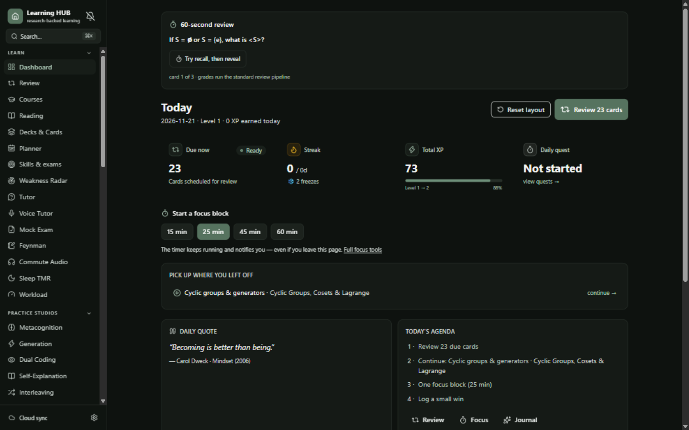
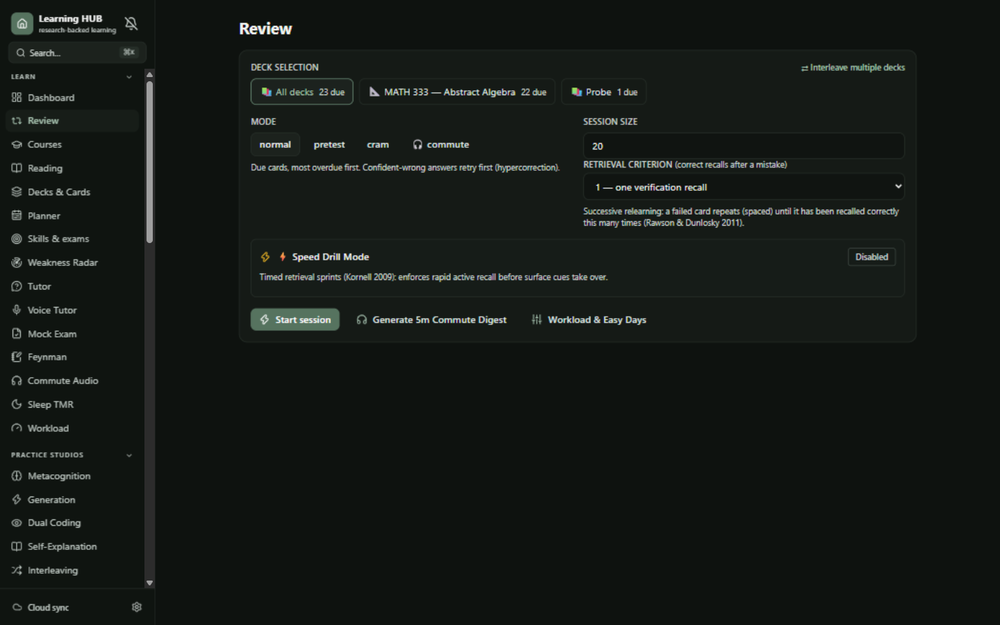
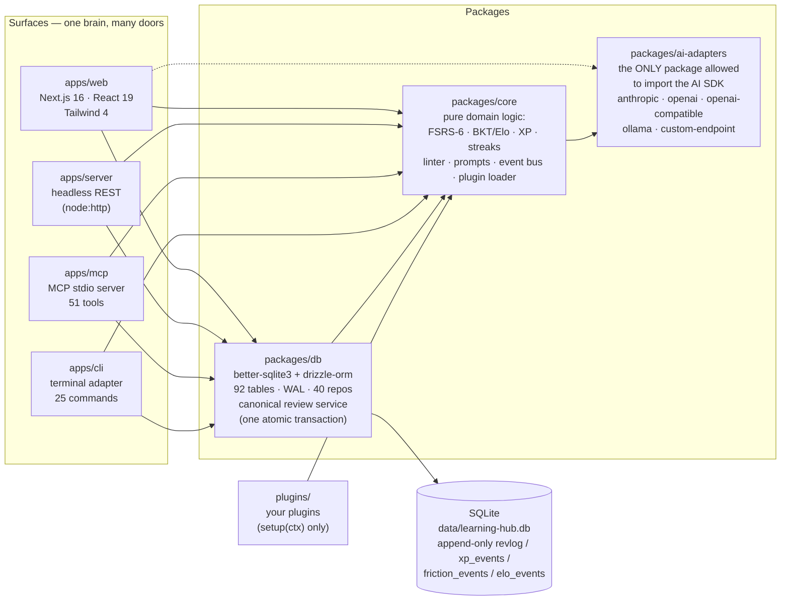

<div align="center">

# Learning HUB

**The research-backed self-learning system** — every high-effect learning method from the literature (spaced repetition, retrieval practice, interleaving, elaboration, teach-back, memory palaces…), plus addiction defense, motivation science, quotes, an AI-agent-accessible idea system, and a Coursera-style curriculum engine. Local-first. TypeScript. Any AI agent can drive it via MCP.

[](https://github.com/learning-hub/learning-hub/actions/workflows/ci.yml)
[](./LICENSE)
[](https://nodejs.org)

</div>

> Built from ~120 web-searched studies up to 2026 — the science, with primary sources, is summarized in [`docs/PLAN-RESEARCH.md`](docs/PLAN-RESEARCH.md).

<!-- Screenshots: drop these into docs/screenshots/ and they will render here.




-->

| Screenshot                                     | Description                                                                 |
| ---------------------------------------------- | --------------------------------------------------------------------------- |
| `docs/screenshots/dashboard.png` _(add later)_ | Dashboard — due count, streak, quests, daily quote                          |
| `docs/screenshots/review.png` _(add later)_    | Keyboard-driven review session with FSRS scheduling                         |
| `docs/screenshots/focus.png` _(add later)_     | Focus mode with the friction gate (10 s countdown + breathing + reflection) |
| `docs/screenshots/weekly.png` _(add later)_    | Weekly report — metrics, weakest cards, forecast, suggestions               |

## Quick start

```bash
npm install        # already done if node_modules exists
npm run db:push    # create/refresh SQLite schema (data/learning-hub.db)
npm run db:seed    # quotes library + achievements + defaults
npm run dev        # → http://localhost:3000
```

Tests: `npm test` · CLI: `npm run cli -- stats` · MCP server: `npm run mcp` · Headless API: `npm run serve`

## Systems (26)

**Learning core** — FSRS-6 engine (ts-fsrs 6, desired retention 0.9) · cards: basic / cloze / stepwise MCQ / type-in / image occlusion / proof-step / grammar · 20-Rules card linter + Deck Doctor · interleaved sessions · pretest mode · worked-example fading · hypercorrection queue · confidence ratings · Puzzle-Elo ladder · energy system · matching games · memory palaces + Major/PAO trainer · sentence mining (1T) + grammar cards · Feynman teach-back · Socratic tutor (guardrail ladder: never answers before a retrieval attempt) · incremental reading + highlight triage + daily resurfacing · canvas whiteboard · knowledge graph

**Curriculum** — Track→Course→Unit→Lesson (backward design, Bloom verbs) · prerequisite DAG gating · BKT mastery (P(known) ≥ 0.95) + Khan-style levels · mastery challenges · skill tree · AI course generator (topic or PDF import) · exam countdown + mock exams + expressive-writing prompt + honest cram mode

**Human systems** — XP/levels (skill milestones) · streaks + 2 freezes + weekend amulet + emergency 1-card saver · daily quests · WOOP goals + if-then plans · white-hat achievements · habit loops + stacking chains + dopamine menu · focus mode with friction gate (10 s countdown + breathing + reflection — the 57 %-reduction mechanic) · tab-switch leak logging · 10-step detox wizard · commitment contracts · task player with finish-time visibility · small-wins journal + weekly review + AI coach · quotes system · physiology tracker (sleep/exercise/caffeine vs. retention correlations)

**Agent access** — MCP server (stdio), REST API, headless server, CLI: one brain, many doors.

## Connect any AI agent (MCP)

Add to `%APPDATA%\Claude\claude_desktop_config.json` (or `.mcp.json` for Claude Code / Cursor) — point at your clone of this repo:

```json
{
  "mcpServers": {
    "learning-hub": {
      "command": "node",
      "args": ["--import", "tsx", "<absolute path to your clone>/apps/mcp/src/index.ts"]
    }
  }
}
```

(On Windows never spawn bare `npx` — use `node --import tsx <abs path>`.)

Tools: 51 built-in tools across all 13 knowledge, review, focus, and cognitive domains + dynamic plugin contributions · Resources: `idea://{id}`, `note://{id}`, `graph://overview`.

Inspect: `npx @modelcontextprotocol/inspector node --import tsx apps/mcp/src/index.ts`

## Headless server, Anki in/out, weekly report

- **Headless REST server** — `npm run serve` exposes the same brain over Node 22+ native `http` (no web framework): `GET /today`, `GET /decks`, `POST /review`, `POST /review/batch`, `GET /stats`, `GET /plugins`, plus optional webhooks on the event bus (`LEARNING_HUB_WEBHOOKS`). Binds `127.0.0.1` by default and ships **no auth** — see [`docs/api-server.md`](docs/api-server.md) before widening the host.
- **Anki import/export** — Settings → Import accepts Anki `.apkg` (≤ 50 MB), Anki plain-text exports (TSV with `#separator`/`#html` headers), and our deck JSON; invalid cards are skipped and reported, never half-inserted. Export any deck as Anki-importable `.txt` (cloze syntax restored) or full-fidelity JSON via `/api/export`.
- **Weekly report** — `GET /api/weekly` computes metrics, weakest cards, the 30-day forecast and study suggestions over your real rows (local-day bucketed, deterministic math); suggestions are AI-optional — with a provider you get evidence-based coaching, without one you get a rule-based summary plus a copy-paste coach prompt ([`docs/ai-providers.md`](docs/ai-providers.md)).

## AI is optional, not required

Learning HUB runs **fully without AI** — `none` is the default provider, every AI surface shows its manual alternative, and no API key is ever needed. When you _do_ want AI (Settings → AI provider):

| Provider            | Needs                                          | Notes                                                                                                         |
| ------------------- | ---------------------------------------------- | ------------------------------------------------------------------------------------------------------------- |
| `anthropic`         | API key                                        | default model `claude-sonnet-4-5`                                                                             |
| `openai`            | API key                                        | default model `gpt-4o-mini`                                                                                   |
| `google`            | API key                                        | default model `gemini-2.5-flash` (@ai-sdk/google)                                                             |
| `openai-compatible` | API key + base URL                             | GLM, DeepSeek, any OpenAI-compatible endpoint                                                                 |
| `ollama`            | base URL (default `http://localhost:11434/v1`) | local, free                                                                                                   |
| `custom-endpoint`   | base URL (+ optional headers JSON)             | **any** HTTP service becomes a provider — POST `{ v, feature, system, prompt, schema }`, respond `{ result }` |
| `none`              | nothing                                        | **the default**                                                                                               |

- **Prompt transport (copy-paste mode)** — every AI feature can be driven with no provider at all: fetch the self-contained prompt envelope (`GET /api/ai/transport?feature=…`), paste it into any chatbot, paste the raw reply back — the app strips fences, extracts the JSON and validates it with the _same_ zod schema an in-process provider must satisfy.
- **Manual modes** — every feature has a structured manual alternative (Socratic → self-explain ladder, Feynman → teach a real person + rubric, course generator → manual curriculum builder, ideas council → four persona prompts on paper…). The invariant "every AI feature has a manual mode" is test-enforced.

Full details: the provider registry, the custom-endpoint HTTP contract, the feature list and the "add a provider" checklist live in [`docs/ai-providers.md`](docs/ai-providers.md).

## Plugins — grow the product without touching it

Everything is an extension point: hosts (web, MCP, CLI, server) load plugins at startup, and a plugin is a single `setup(ctx)` function. React to platform events (`review.completed`, `streak.broken`, …), contribute MCP tools, or contribute CLI commands — no base classes, no forks. Drop a folder into `plugins/` (a reference `example-echo` plugin is included) or publish to npm.

See [`docs/plugins.md`](docs/plugins.md) for the contract, the event catalog, failure isolation, and a testing recipe.

## E2E walkthrough

1. `npm run dev` → Dashboard shows due count, streak, quests, daily quote
2. **Decks** → new deck → new cloze card (`{{c1::Paris}} is the capital of France`) → save (linter runs)
3. **Review** → answer with keyboard 1-4 → XP/streak/quest update live
4. **Focus** → start 25 min → click "end early" → friction gate enforces 10 s countdown + breathing + reflection
5. **Reading** → paste article → highlight → triage → make flashcard
6. **Curriculum** → generate course from topic or PDF → skill tree unlocks by mastery
7. **Feynman** → explain a concept → AI student asks follow-ups → graded, gap-cards created
8. **Ideas** → capture 2 ideas → evolve → hybrid offspring linked
9. **MCP** → inspector lists all tools; `npm run cli -- stats` works
10. **Analytics** → true retention, forecast, calibration, heat map

## Architecture



- **One canonical review pipeline** — every surface calls the same `executeReview()` in `packages/db`: one atomic transaction (FSRS card update + append-only `revlog` + XP event + streak + Elo/BKT mastery), then `review.completed` on the core event bus.
- **Event bus** — durable facts emit typed events (`packages/core/src/events.ts`); plugins subscribe, hosts forward webhooks. Listeners never break the emitter.
- **Dependency rule** — `core` imports no AI SDK, `ai-adapters` is the only one that does, plugins depend on `core` only, and `db` owns every transaction. Details in [`ARCHITECTURE.md`](ARCHITECTURE.md).

## Development

```bash
npm run check      # typecheck + unit tests across all workspaces
npm run lint       # ESLint
npm run format     # Prettier
npm run test:e2e   # opaque-box E2E suite (API + CLI + MCP + DB) — see docs/TEST_INFRA.md
npm run build      # production build
```

## Contributing

Contributions are welcome — bug fixes, new learning systems, plugins, AI providers. See [`CONTRIBUTING.md`](CONTRIBUTING.md) for dev setup, the workspace map, code standards, and the PR flow.

Please note the [`CODE_OF_CONDUCT.md`](CODE_OF_CONDUCT.md) applies to all project spaces, and report security issues via [`SECURITY.md`](SECURITY.md) (not a public issue).

## License

Released under the [MIT License](./LICENSE). © 2026 Learning HUB contributors.

## Roadmap (deferred)

- AI video-call roleplay — deliberate: synchronous video adds hosting cost and
  complexity; the voice tutor (offline-capable) covers the pedagogy today.
- Full CRDT sync — LWW sync v1 is live; CRDT merge is the follow-up when
  concurrent-edit evidence justifies it (see [docs/plan-M19-M21.md](docs/plan-M19-M21.md)).

Shipped items (Multi-device sync v1 E2EE, party boss battles, FSRS optimizer UI,
browser-extension friction capture, per-card TTS, native Windows/Android shells)
live in [CHANGELOG.md](CHANGELOG.md).
