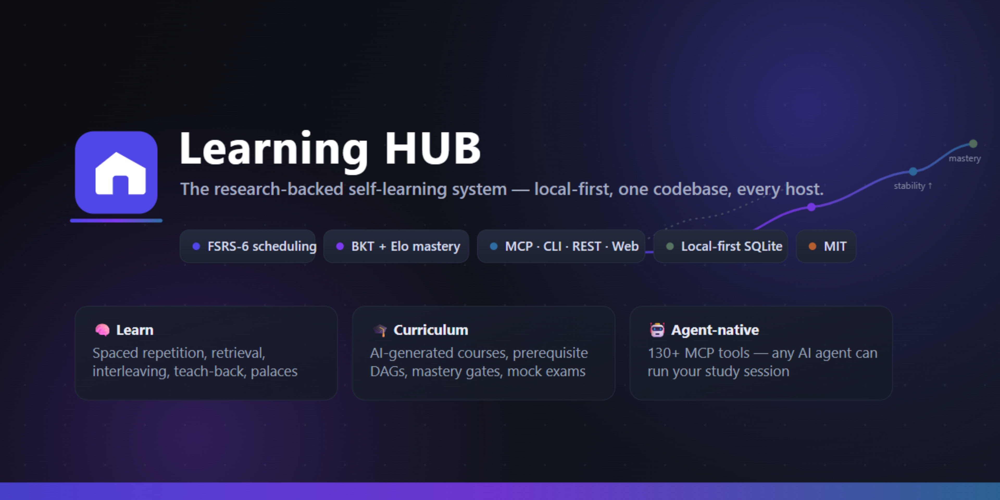
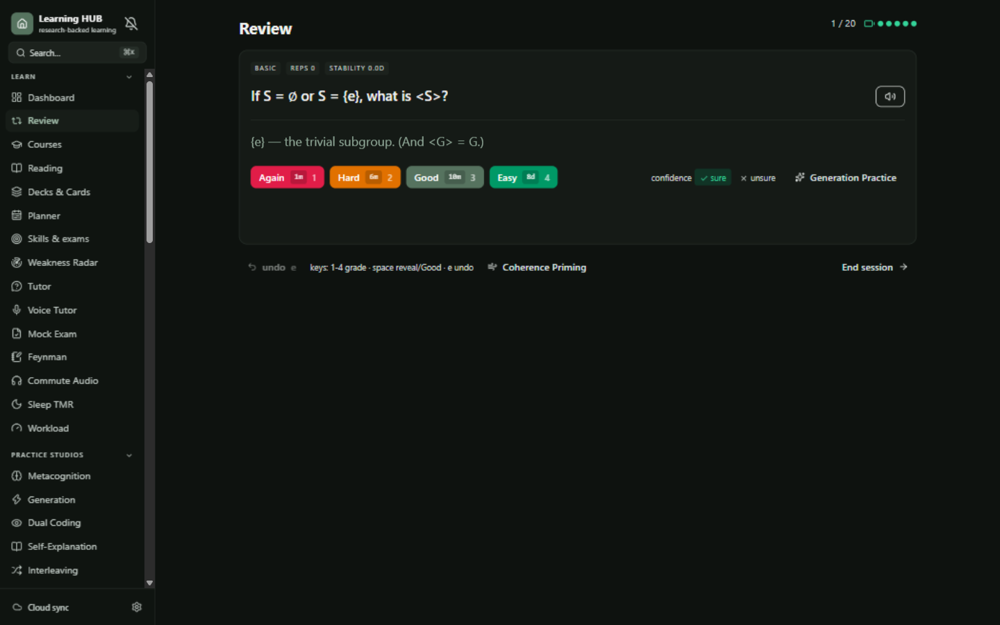
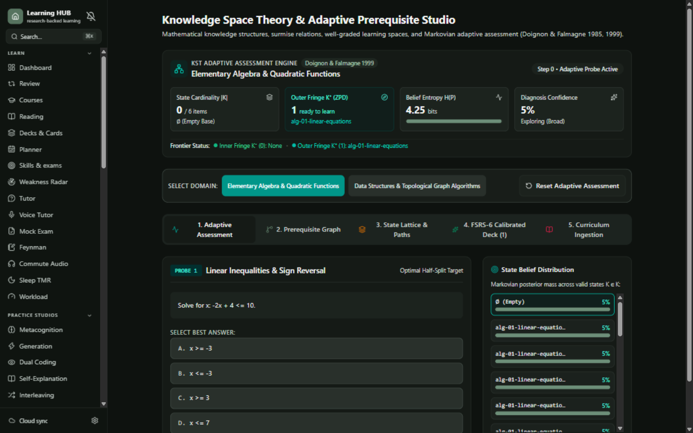
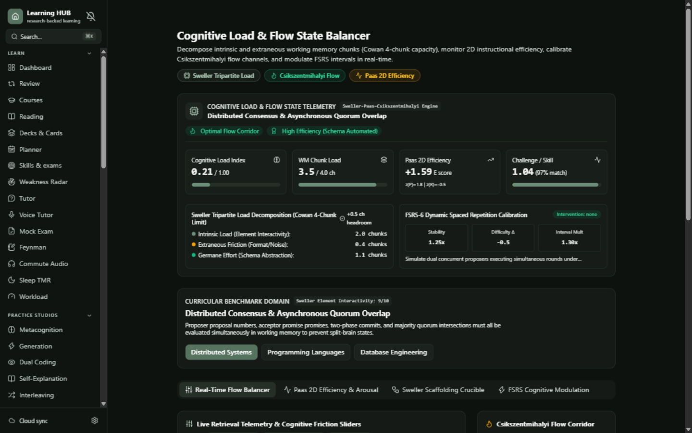
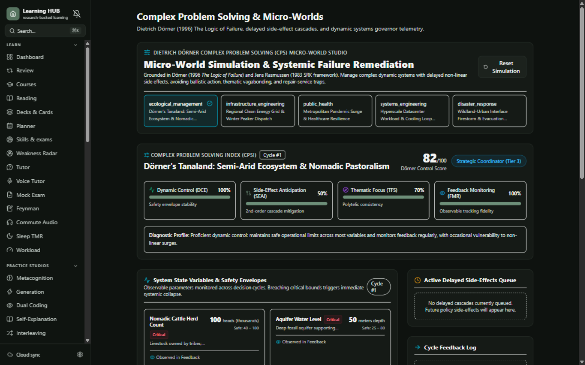
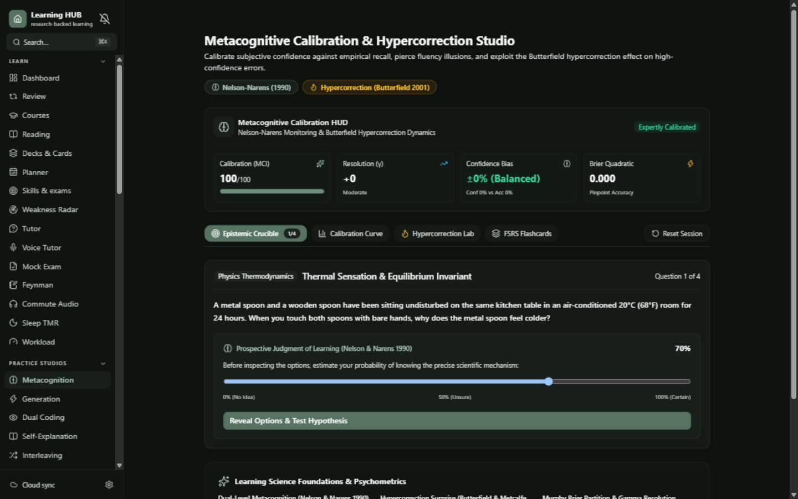
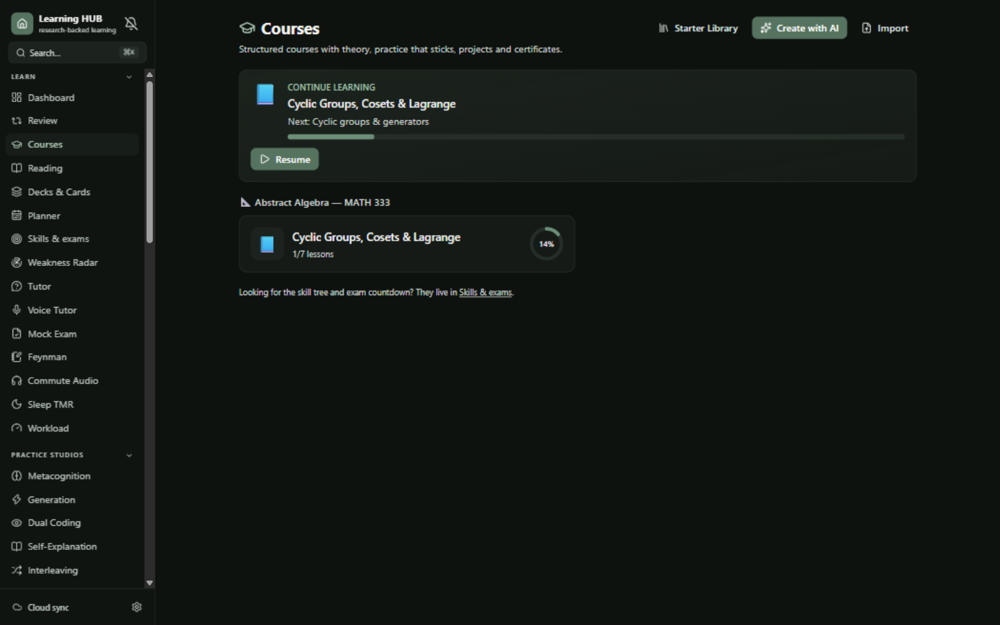
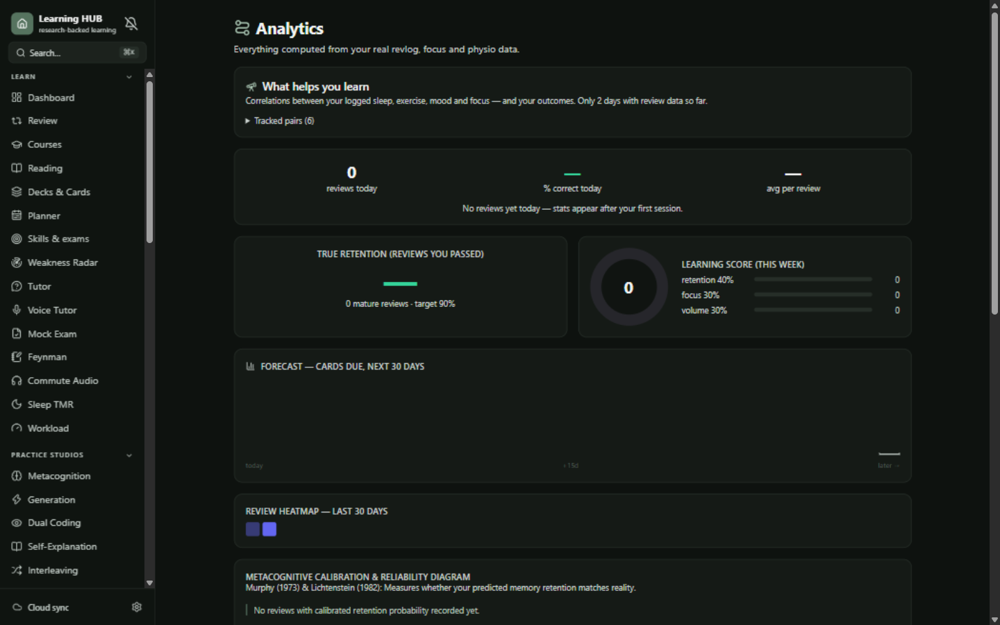

<div align="center">



**Every high-effect learning method from the literature — in one local-first app you own.**

Spaced repetition (FSRS-6) · retrieval practice · interleaving · elaboration · teach-back · memory palaces ·
calibration training · AI-generated curricula · motivation & habit science · an idea inbox · a full MCP server
so any AI agent can run your study session.

[](https://github.com/Agono0/learning-hub/actions/workflows/ci.yml)
[](./LICENSE)
[](https://nodejs.org)
[](./CONTRIBUTING.md)
[](#connect-any-ai-agent-mcp)

[Quickstart](#quick-start) · [Screenshots](#-see-it) · [Learning science](#-built-on-learning-science) ·
[For AI agents](#connect-any-ai-agent-mcp) · [Contributing](#-contributing) · [Docs](#-documentation)

</div>

---

## Why Learning HUB?

Most study apps pick **one** technique and stop. Learning HUB implements the _whole_ evidence base — ~120
primary studies up to 2026, mapped to code in [docs/PLAN-RESEARCH.md](docs/PLAN-RESEARCH.md) — and makes them
work **together**: a hypercorrection engine feeds your FSRS queue, calibration training reads your revlog,
focus sessions fight tab-switching with a friction gate, and every claim is computable from your own data.

**Local-first. Your data never leaves the machine.** One SQLite file (`data/learning-hub.db`, 94 tables, 29
idempotent migrations) powers every surface: the web app, Windows/Android native shells, the CLI, the headless
REST server, and the MCP server. No accounts, no cloud, no telemetry. (Optional end-to-end-encrypted sync is a
module you can turn on.)

**Agent-native.** 128 MCP tools mean Claude, Cursor, Cline or any MCP client can list what's due, run a review
session, grade it, plan your curriculum, or audit your calibration — the same engine, the same DB, the same
canonical grading path as the UI.

**AI optional, never required.** `none` is the default provider; every AI surface has a structured manual
alternative and a copy-paste prompt transport (see [below](#ai-is-optional-not-required)).

## 👀 See it

|                                                                                                                                                                                                                                                                                                    |                                                                                                                                                                                                                                                |
| -------------------------------------------------------------------------------------------------------------------------------------------------------------------------------------------------------------------------------------------------------------------------------------------------- | ---------------------------------------------------------------------------------------------------------------------------------------------------------------------------------------------------------------------------------------------- |
|                                                                                                                                                                                                                                                        |                                                                                                                                                                                          |
| **Dashboard** — due count, streak & freezes, XP level, daily quest, agenda, daily quote, and a 60-second quick-review — all computed from your real revlog.                                                                                                                                        | **Review session** — keyboard-driven FSRS-6 grading with confidence ratings, coherence priming, successive relearning (failed cards repeat until correctly recalled — Rawson & Dunlosky 2011), and undo.                                       |
|                                                                                                                                                                                                                              |                                                                                                                                                                          |
| **Knowledge Space Theory studio** — Doignon & Falmagne's mathematical knowledge structures: surmise relations, Markovian adaptive assessment, belief-state posterior, FSRS-calibrated prerequisite decks.                                                                                          | **Cognitive Load & Flow balancer** — Sweller's tripartite load decomposition (intrinsic / extraneous / germane), Cowan's 4-chunk capacity, Paas 2D efficiency and a Csikszentmihalyi flow corridor that modulates FSRS intervals in real time. |
|                                                                                                                                                                                                                |                                                                                                                                                                                     |
| **Complex Problem Solving** — Dörner's _Logic of Failure_ micro-worlds: delayed side-effect cascades, safety envelopes, and a CPS index scoring dynamic control, side-effect anticipation and thematic focus.                                                                                      | **Metacognition studio** — calibration curve, Goodman-Kruskal γ resolution, Brier decomposition, and the Butterfield hypercorrection effect: your high-confidence errors get fast-tracked into the relearning queue.                           |
|                                                                                                                                                                                                                                                            |                                                                                                                                                                                                    |
| **Curriculum** — Track → Course → Unit → Lesson with backward design, prerequisite DAG gating, BKT mastery (P(known) ≥ 0.95), mock exams and certificates. Generate a course from any topic or PDF with any AI — or import one from your favorite LLM in [LHCF format](docs/curriculum/PROMPT.md). | **Analytics** — true retention, 30-day due forecast, review heatmap, hour-of-day accuracy and physio correlations (sleep / exercise / caffeine vs. recall). Everything computed from your own rows — no black boxes.                           |

_Dark mode is the default; the full design system (tokens, motion, kit) is documented in
[docs/ui-design-signature.md](docs/ui-design-signature.md)._

## 🧪 Built on learning science

Every feature cites its literature, in code and in [docs/learning-science.md](docs/learning-science.md). A few of the engines:

| Technique                                              | Researchers                                  | Where                                                  |
| ------------------------------------------------------ | -------------------------------------------- | ------------------------------------------------------ |
| Spaced repetition (FSRS-6, 21-parameter optimizer)     | Tsay et al. 2023 · ts-fsrs                   | `packages/core/src/fsrs`                               |
| Retrieval practice & successive relearning             | Roediger & Karpicke 2006 · Rawson & Dunlosky | `packages/core/src/practice`, `successive-relearning`  |
| Interleaving & structural invariance                   | Rohrer & Taylor 2007                         | `packages/core/src/interleaving`                       |
| Hypercorrection of high-confidence errors              | Butterfield & Metcalfe 2001                  | `packages/core/src/metacognition`                      |
| Calibration (Brier decomposition, Goodman-Kruskal γ)   | Murphy 1973 · Nelson & Narens 1990           | `packages/core/src/metacognition`, `analytics`         |
| Bayesian knowledge tracing + Elo                       | Corbett & Anderson 1995 · Pelánek            | `packages/core/src/bkt`, `elo`                         |
| Cognitive load theory & element interactivity          | Sweller 1988/2011 · Cowan 2001               | `packages/core/src/cognitive-load`, `interactivity`    |
| Reflective equilibrium & fox/hedgehog forecasting      | Rawls · Tetlock                              | `packages/core/src/equilibrium`                        |
| Complex problem solving (micro-worlds)                 | Dörner 1996                                  | `packages/core/src/complex-problem-solving`            |
| Knowledge space theory (adaptive assessment)           | Doignon & Falmagne 1985/1999                 | `packages/core/src/knowledge-space`                    |
| Dual coding & multimedia                               | Paivio 1971/1986 · Mayer 2001                | `packages/core/src/dualcoding`                         |
| Memory palaces / method of loci                        | leg. Simonides · Maguire et al. 2003         | `packages/core/src/spatial`                            |
| Friction gate (the 57 % tab-switch reduction mechanic) | Small et al. · Ariely & Wertenbroch          | `packages/core/src/focus-lock`                         |
| Habit loops, WOOP goals, commitment contracts          | Fogg · Oettingen & Gollwitzer                | `packages/core/src/habits`, `freshStart`, `motivation` |

**Addiction defense & honest motivation:** streak freezes instead of guilt, weekend amulets, an emergency
1-card saver, white-hat achievements only, finish-time visibility, and no dark patterns — calm-by-default is
enforced in the [UI design law](docs/ui-design-signature.md).

## Quick start

```bash
git clone https://github.com/Agono0/learning-hub.git
cd learning-hub
npm install
npm run db:push    # create/refresh the SQLite schema → data/learning-hub.db
npm run db:seed    # quotes library, achievements, defaults
npm run dev        # → http://localhost:3000
```

- **Native:** `npm run app:dev` (Windows) or `npm run android:dev` — data lives in OPFS scoped to the app.
- **CLI:** `npm run cli -- today` · `review` · `stats` · `focus 25` · `curriculum list` … (58 built-in commands)
- **Headless API:** `npm run serve` → `GET /today`, `POST /review`, `GET /cognitive/load/benchmarks`, …
- **Anki in/out** — import `.apkg` / plain-text exports; export any deck as Anki-importable `.txt` or JSON.

## Connect any AI agent (MCP)

Add to `%APPDATA%\Claude\claude_desktop_config.json` (or `.mcp.json` for Claude Code / Cursor) — point at
your clone of this repo:

```json
{
  "mcpServers": {
    "learning-hub": {
      "command": "node",
      "args": ["--import", "tsx", "<absolute path to your clone>/apps/mcp/src/index.ts"]
    }
  }
}
```

(On Windows never spawn bare `npx` — use `node --import tsx <abs path>`.)

128 built-in tools across 15 knowledge, review, focus, and cognitive domains + dynamic plugin contributions ·
Resources: `idea://{id}`, `note://{id}`, `graph://overview`. Inspect with
`npx @modelcontextprotocol/inspector node --import tsx apps/mcp/src/index.ts`.

Then try: _"What's due today?"_ · _"Run a 20-card review and grade my answers"_ · _"Build me a course on
information theory with mastery gates"_ · _"How well calibrated am I this month?"_ — the agent drives the
same grading path the UI uses.

## AI is optional, not required

Learning HUB runs **fully without AI** — `none` is the default provider, every AI surface shows its manual
alternative, and no API key is ever needed. When you _do_ want AI (Settings → AI provider):

| Provider            | Needs                                          | Notes                                                                                                         |
| ------------------- | ---------------------------------------------- | ------------------------------------------------------------------------------------------------------------- |
| `anthropic`         | API key                                        | default model `claude-sonnet-4-5`                                                                             |
| `openai`            | API key                                        | default model `gpt-4o-mini`                                                                                   |
| `google`            | API key                                        | default model `gemini-2.5-flash` (@ai-sdk/google)                                                             |
| `openai-compatible` | API key + base URL                             | GLM, DeepSeek, any OpenAI-compatible endpoint                                                                 |
| `ollama`            | base URL (default `http://localhost:11434/v1`) | local, free                                                                                                   |
| `custom-endpoint`   | base URL (+ optional headers JSON)             | **any** HTTP service becomes a provider — POST `{ v, feature, system, prompt, schema }`, respond `{ result }` |
| `none`              | nothing                                        | **the default**                                                                                               |

- **Prompt transport (copy-paste mode)** — every AI feature can be driven with no provider at all: fetch the
  self-contained prompt envelope (`GET /api/ai/transport?feature=…`), paste it into any chatbot, paste the raw
  reply back — the app strips fences, extracts the JSON and validates it with the _same_ zod schema an
  in-process provider must satisfy.
- **Manual modes** — every feature has a structured manual alternative (Socratic → self-explain ladder,
  Feynman → teach a real person + rubric, course generator → manual curriculum builder…). The invariant
  "every AI feature has a manual mode" is test-enforced.

Full details: the provider registry, the custom-endpoint HTTP contract and the "add a provider" checklist live
in [`docs/ai-providers.md`](docs/ai-providers.md).

## Shared channels — living decks and courses

Publish any deck or course as a **channel**, share the link (or invite tokens for private
circles), and keep teaching after you publish: every update you ship reaches subscribers as a
versioned, checksummed manifest they can review and apply. The merge never overwrites the
learner — notes, FSRS scheduling state, progress and local edits are sacred; conflicts are
surfaced, not silently resolved. Subscriptions sync from any static HTTPS host or a peer hub,
and one click imports a channel into your library as a reviewable deck or a full curriculum
course that stays current as the creator publishes. See
[`docs/share-channels.md`](docs/share-channels.md).

## Plugins — grow the product without touching it

Everything is an extension point: hosts (web, MCP, CLI, server) load plugins at startup, and a plugin is a
single `setup(ctx)` function. React to platform events (`review.completed`, `streak.broken`, …), contribute
MCP tools, or contribute CLI commands — no base classes, no forks. Drop a folder into `plugins/` (a reference
`example-echo` plugin is included) or publish to npm. See [`docs/plugins.md`](docs/plugins.md).

## E2E walkthrough

1. `npm run dev` → Dashboard shows due count, streak, quests, daily quote
2. **Decks** → new deck → new cloze card (`{{c1::Paris}} is the capital of France`) → save (linter runs)
3. **Review** → answer with keyboard 1-4 → XP/streak/quest update live
4. **Focus** → start 25 min → click "end early" → friction gate enforces 10 s countdown + breathing + reflection
5. **Reading** → paste article → highlight → triage → make flashcard
6. **Curriculum** → generate course from topic or PDF → skill tree unlocks by mastery
7. **Studios** → calibration, cognitive load, KST adaptive assessment, Dörner micro-worlds — 30+ research-backed practice studios
8. **Ideas** → capture 2 ideas → evolve → hybrid offspring linked
9. **MCP** → inspector lists all tools; `npm run cli -- stats` works
10. **Analytics** → true retention, forecast, calibration, heat map

## Architecture


- **One canonical review pipeline** — every surface calls the same `executeReview()` in `packages/db`: one
  atomic transaction (FSRS card update + append-only `revlog` + XP event + streak + Elo/BKT mastery), then
  `review.completed` on the core event bus.
- **Event bus** — durable facts emit typed events (`packages/core/src/events.ts`); plugins subscribe, hosts
  forward webhooks. Listeners never break the emitter.
- **Dependency rule** — `core` imports no AI SDK, `ai-adapters` is the only one that does, plugins depend on
  `core` only, and `db` owns every transaction. The cross-host parity suite asserts the web app, the headless
  server and the MCP subprocess answer identically for the same learner. Details in
  [`ARCHITECTURE.md`](ARCHITECTURE.md).

## 🤝 Contributing

Contributions are welcome — bug fixes, new learning systems, plugins, AI providers, docs. Read
[`CONTRIBUTING.md`](CONTRIBUTING.md), then:

1. **Pick something.** Good first changes: a new practice studio, a CLI command for an engine missing one, a
   host-parity route, a doc improvement, or a test that pins a documented claim.
2. **Scaffold fast.** One command generates a full feature (core domain + test, handler, route shim, page,
   nav + registry wiring): `npm run new:feature -- my-feature --title "My Feature" --group Discipline`.
3. **Follow the manual.** [`AGENTS.md`](AGENTS.md) is the operating manual — the hard rules (no raw `fetch`
   in UI code, zod at every boundary, one grading path, schema changes need a migration) are enforced by
   ESLint, structural guard tests, and CI.
4. **Local gate only:** `npm run typecheck && npm run lint && npm run format:check`. **Never build or run
   tests locally** — CI is the only test gate and runs the full unit + e2e + parity + build matrix on every
   PR. Machines vary; CI is the arbiter.
5. **Conventional Commits** (commitlint-enforced), atomic PRs, CI green before merge.

Please note the [`CODE_OF_CONDUCT.md`](CODE_OF_CONDUCT.md) applies to all project spaces, and report security
issues via [`SECURITY.md`](SECURITY.md) (not a public issue).

## 📚 Documentation

| Start here                                                 | What it is                                              |
| ---------------------------------------------------------- | ------------------------------------------------------- |
| [docs/README.md](docs/README.md)                           | the full docs index                                     |
| [docs/PLAN-RESEARCH.md](docs/PLAN-RESEARCH.md)             | ~120 studies behind every feature, with primary sources |
| [docs/learning-science.md](docs/learning-science.md)       | technique → code map                                    |
| [ARCHITECTURE.md](ARCHITECTURE.md)                         | the one-codebase hub architecture                       |
| [docs/curriculum/PROMPT.md](docs/curriculum/PROMPT.md)     | LHCF — the public curriculum contract for any AI        |
| [docs/ai-providers.md](docs/ai-providers.md)               | provider registry + manual modes                        |
| [docs/native.md](docs/native.md)                           | Windows & Android shells, OPFS storage                  |
| [docs/plugins.md](docs/plugins.md)                         | plugin contract, event catalog, testing recipe          |
| [docs/api-server.md](docs/api-server.md)                   | headless REST server + webhooks                         |
| [docs/adr/README.md](docs/adr/README.md)                   | architecture decision records                           |
| [docs/TEST_INFRA.md](docs/TEST_INFRA.md)                   | the test pyramid                                        |
| [docs/ui-design-signature.md](docs/ui-design-signature.md) | the design language                                     |

## Development

```bash
npm run typecheck      # typecheck across all workspaces   ← local gate
npm run lint           # ESLint                            ← local gate
npm run format:check   # Prettier                          ← local gate
```

```bash
npm test        # unit tests — CI ONLY
npm run test:e2e    # opaque-box E2E (API + CLI + MCP + DB) — CI ONLY (docs/TEST_INFRA.md)
npm run build       # production build — CI ONLY
npm run check       # typecheck + unit tests — CI ONLY
```

> **Why?** Machines vary; CI is the arbiter. The pre-push gate is exactly typecheck + lint + format:check —
> the full test/build matrix (unit, e2e, cross-host parity, Playwright, Next build, Tauri bundle) runs on
> GitHub Actions for every PR and must be green before merge.

## 🗺️ Roadmap

- AI video-call roleplay — deliberately deferred: synchronous video adds hosting cost and complexity; the
  voice tutor (offline-capable) covers the pedagogy today.
- Full CRDT sync — LWW sync v1 is live; CRDT merge is the follow-up when concurrent-edit evidence justifies
  it (see [docs/plan-M19-M21.md](docs/plan-M19-M21.md)).
- Remaining engine content/logic splits and doc-claim guard tests — tracked, with evidence, in
  [docs/tech-debt.md](docs/tech-debt.md).

Shipped items (multi-device sync v1 E2EE, party boss battles, FSRS optimizer UI, browser-extension friction
capture, per-card TTS, native Windows/Android shells, 30+ research-backed studios) live in
[CHANGELOG.md](CHANGELOG.md).

## ⭐ Support the project

If Learning HUB helps you learn, a star helps others find it. Bug reports and
_"this study says X, the app should do Y"_ issues are the most valuable contributions of all.

<a href="https://star-history.com/#Agono0/learning-hub&Date">
  <picture>
    <source media="(prefers-color-scheme: dark)" srcset="https://api.star-history.com/svg?repos=Agono0/learning-hub&type=Date&theme=dark" />
    <source media="(prefers-color-scheme: light)" srcset="https://api.star-history.com/svg?repos=Agono0/learning-hub&type=Date" />
    
  </picture>
</a>

## 🙏 Acknowledgments

Built on the open work of many researchers and projects: the **FSRS** algorithm and
[ts-fsrs](https://github.com/open-spaced-repetition/ts-fsrs) (open-spaced-repetition), **Anki** (Damien
Elmes) whose scheduling concepts informed the review pipeline, **Tauri**, **Next.js**, **better-sqlite3**,
**drizzle-orm**, **Model Context Protocol** (Anthropic), and the primary literature cited throughout
[docs/PLAN-RESEARCH.md](docs/PLAN-RESEARCH.md) — from Ebbinghaus (1885) to Dörner (1996) to the FSRS papers
(2023+).

## 📄 License

Released under the [MIT License](./LICENSE). © 2026 Learning HUB contributors.
